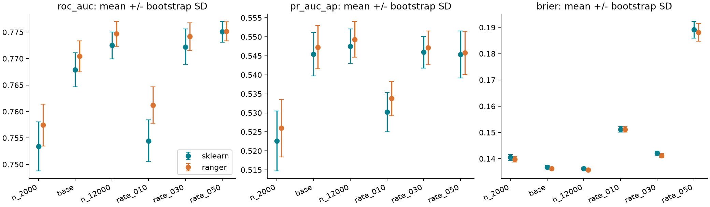
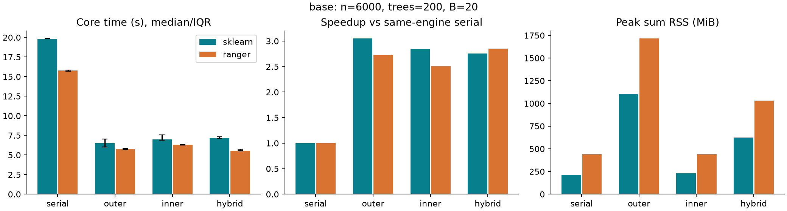

# 基于随机森林的信用违约预测与并行计算

> 计算机课程期末项目｜陈秀萍（2026001406）、何韫琪(2026001407)
>
> GitHub：<https://github.com/XiupingChen/final-2026001406-2026001407>
>

> 本 README 分别列出 macOS 正式实验与 Windows 独立复现。Windows 的修复、原始结果及复现命令见 [WINDOWS_REPRODUCTION.md](WINDOWS_REPRODUCTION.md)。两台机器的绝对时间和加速比不合并。修订后的 Word 报告已纳入两套结果,具体见report.pdf。

## 1. 项目简介

我们选择信用卡客户违约预测作为课程期末项目。这个问题一方面具有现实应用背景，另一方面也包含课程中值得研究的计算问题：随机森林需要反复训练大量决策树；为了评价结果的稳定性，我们又在外层进行了多次 Bootstrap 重采样，因此完整实验同时存在“单次模型内部并行”和“多次重复任务之间并行”两类计算机会。

项目使用 UCI **Default of Credit Card Clients** 数据，主模型为随机森林，完整模型分别由 Python 的 scikit-learn 和 R 的 ranger 运行。我们没有只调用现成模型后报告一个准确率，而是围绕以下三个问题组织实验：

1. 训练样本量以及训练集违约比例如何影响随机森林的区分能力、少数类识别能力和概率校准？
2. 在相同的 4 个 CPU 配额下，串行、外层并行、内层并行和混合并行哪一种调度更合适？
3. 当样本量 $n$、外层 Bootstrap 次数 $B$ 和树数 $T$ 分别变化时，运行时间与预测质量如何变化？

除完整森林实验外，我们还自行实现了 NumPy 直方图 Gini 分裂、穷举参考分裂、教学随机森林，以及 R/Rcpp 版本的同算法分裂内核，用于验证算法理解、数值正确性和跨语言性能差异。自写内核只用于单节点分裂实验，并未替代 scikit-learn 或 ranger 的完整随机森林实现。

## 2. 成员分工

| 成员 | 主要工作 |
|---|---|
| 陈秀萍 | 数据清洗与审计；阶段一预测实验；核查特征处理、类别不平衡和预测指标；整理结果、README 与实验报告 |
| 何韫琪 | R/ranger 与 Rcpp 环境；四种并行调度；阶段二和阶段三实验；核查计时、公平比较和内存记录 |
| 两人共同 | 复核 Python、R 和 Rcpp 正确性测试；解释两层 Bootstrap 与分裂内核；交叉检查代码、结果和课程汇报材料 |

两位成员均能够解释数据处理、完整随机森林、两层 Bootstrap、并行调度以及自写分裂内核。

## 3. 数据、模型与实验设计

### 3.1 数据清洗

原始数据共有 30,000 个样本、23 个预测字段和 1 个二元违约标签，其中违约样本 6,636 个，原始违约率为 22.12%。本项目的清洗原则是尽量保留原始信息，并把每一步写入审计文件：

- 检查字段名、字段类型、标签取值、ID 唯一性、重复行和缺失值；
- ID 不进入模型，但保存在 `row_mapping.csv` 中，便于追溯；
- `EDUCATION` 的 0、5、6 合并为 4，共调整 345 条记录；
- `MARRIAGE` 的 0 合并为 3，共调整 54 条记录；
- 还款状态中的 -2、-1 以及账单金额中的负值具有业务含义，因此保留；
- 原数据没有缺失值，不需要实际填补，也没有删除任何样本；
- 审计文件保存原始文件与清洗文件的 SHA-256、前后行数、类别计数和编码调整量。

类别变量的独热编码和中位数预处理均只在训练数据上拟合，验证集和测试集不参与拟合。整个项目固定一次 60%/20%/20% 的分层划分，验证集用于选择 F1 最大的阈值，测试集只用于最终评价。

### 3.2 两层 Bootstrap 与评价指标

阶段一和阶段三使用两层随机过程：外层 Bootstrap 重采样训练数据，用于观察训练扰动下的结果稳定性；内层随机森林再对样本和特征进行随机化。我们为每个任务预先生成 Bootstrap 行号与模型随机种子，使两个引擎和不同调度模式使用相同输入。

预测质量同时报告：

- ROC-AUC：总体排序能力；
- AP（Average Precision）：更关注少数类的排序表现；
- Brier 分数：概率预测的均方误差，越小越好；它同时受校准和区分能力影响，不能单独作为校准误差；
- 固定阈值 0.5 下的 Recall；
- 验证集选定阈值后，测试集上的 Precision、Recall、F1 和混淆矩阵。

我们还使用每次训练 Bootstrap 样本中的违约率作为常数概率基准。该基准不使用测试标签，避免信息泄漏。20 次 Bootstrap 的标准差表示训练扰动下的波动，不把它解释为总体泛化误差的置信区间。

### 3.3 三个正式实验

| 阶段 | 主要设置 | 研究目的 |
|---|---|---|
| 阶段一：预测与类别比例 | $n=2,000/6,000/12,000$；训练违约率 10%/自然比例/30%/50%；$T=200,B=20$ | 比较样本量、训练类别比例与预测质量 |
| 阶段二：并行调度 | $n=6,000,T=200,B=20$；4 CPU；每种模式重复计时 5 次 | 比较串行 1×1、外层 4×1、内层 1×4、混合 2×2 |
| 阶段三：规模变化 | 从 $n=6,000,T=200,B=20$ 出发，分别改变 $n$、$T$、$B$；重复计时 3 次 | 分离观察样本、树数和任务数的时间伸缩 |

阶段二和阶段三的计时分为两个口径。`core_seconds` 在数据载入和 3 棵树预热之后开始，包含 Bootstrap 数据实体化、模型拟合、验证/测试预测和进程间通信；`process_seconds` 记录独立进程从启动到结束的完整时间。编译、结果汇总、画图和一致性核对均不计入核心时间。

## 4. macOS 主要结果

### 4.1 预测质量

在自然类别比例下，增加训练样本量能稳定提高预测质量。下面报告 20 次外层 Bootstrap 的均值；括号内为标准差。

| 引擎 | 训练量 | ROC-AUC | AP | Brier | 测试 F1 |
|---|---:|---:|---:|---:|---:|
| ranger | 2,000 | 0.7574 (0.0052) | 0.5260 (0.0099) | 0.1397 | 0.5203 |
| ranger | 6,000 | 0.7704 (0.0029) | 0.5473 (0.0057) | 0.1363 | 0.5344 |
| ranger | 12,000 | 0.7747 (0.0017) | 0.5493 (0.0034) | 0.1358 | 0.5353 |
| sklearn | 2,000 | 0.7534 (0.0054) | 0.5226 (0.0106) | 0.1405 | 0.5196 |
| sklearn | 6,000 | 0.7679 (0.0032) | 0.5454 (0.0061) | 0.1368 | 0.5337 |
| sklearn | 12,000 | 0.7725 (0.0019) | 0.5476 (0.0039) | 0.1363 | 0.5338 |

与 $n=2,000$ 相比，$n=12,000$ 时两个引擎的 ROC-AUC 均提高约 0.019，Brier 分数也下降，说明扩大训练样本既改善排序能力，也改善概率预测。两个引擎的绝对数值很接近，变化方向一致。

改变训练违约率时，固定阈值 0.5 下的 Recall 明显变化。以 ranger 为例，训练违约率由 10% 提高到 50% 后，Recall 从 0.1163 上升到 0.6563，但 Brier 分数由 0.1512 增至 0.1881。这说明重采样可以改变分类倾向，却也会改变训练先验，并使本实验的 Brier 分数恶化；校准程度需结合可靠性曲线判断，因此不能只凭召回率升高判断模型整体更好。



### 4.2 并行效率与内存

在 4 个 CPU 配额下，所有并行模式都明显快于串行，但不同调度对两个引擎的效果不同。

| 引擎 | 调度 | 核心时间中位数（秒） | 加速比 | 并行效率 | 峰值 RSS（MiB） |
|---|---|---:|---:|---:|---:|
| sklearn | 串行 | 19.844 | 1.000 | 1.000 | 215.0 |
| sklearn | 外层并行 | 6.509 | 3.049 | 0.762 | 1106.1 |
| sklearn | 内层并行 | 6.974 | 2.845 | 0.711 | 230.2 |
| sklearn | 混合并行 | 7.192 | 2.759 | 0.690 | 625.1 |
| ranger | 串行 | 15.783 | 1.000 | 1.000 | 439.9 |
| ranger | 外层并行 | 5.781 | 2.730 | 0.683 | 1715.0 |
| ranger | 内层并行 | 6.304 | 2.504 | 0.626 | 441.8 |
| ranger | 混合并行 | 5.538 | 2.850 | 0.712 | 1029.9 |

sklearn 的外层并行速度最快，核心时间加速比为 3.05；ranger 的混合并行最快，加速比为 2.85。外层并行需要多个完整模型同时驻留内存，因此峰值 RSS 最大。内层并行的速度略慢，但内存更接近串行。当计算机内存有限时，不能只选择核心时间最短的模式。



### 4.3 规模变化

串行结果显示，树数从 200 增至 400 后，两个引擎的核心时间都接近 2 倍；外层 Bootstrap 次数由 20 增至 40 后，时间同样约为 2 倍。样本量的影响不是严格线性的：sklearn 从 6,000 增至 12,000 时为 2.07 倍，ranger 为 1.76 倍。树数和 Bootstrap 次数主要重复已有计算，因而更接近线性增长；样本量还会改变节点深度、候选切分和固定开销占比。

| 设置 | sklearn 核心时间（秒） | 相对基准 | ranger 核心时间（秒） | 相对基准 |
|---|---:|---:|---:|---:|
| 基准：$n=6,000,T=200,B=20$ | 19.784 | 1.00 | 15.722 | 1.00 |
| $n=2,000$ | 6.946 | 0.35 | 8.181 | 0.52 |
| $n=12,000$ | 40.891 | 2.07 | 27.738 | 1.76 |
| $B=40$ | 39.234 | 1.98 | 31.483 | 2.00 |
| $T=400$ | 39.476 | 2.00 | 31.773 | 2.02 |

### 4.4 Windows 独立复现与补充对照

另一台 Windows 11 电脑使用 Python 3.14.8、R 4.3.3、ranger 0.18.0 和 Rcpp 1.1.2 完成独立运行。原始数据审计仍为 30,000 行、6,636 个违约样本。smoke、阶段一、二、三分别完成 8、12、40、120 项任务；最大调度预测误差为 $3.33\times10^{-16}$。测试记录为 21 项通过、1 项 POSIX 专用测试在 Windows 跳过。

- **阶段一**：自然比例下，训练量从 2,000 增至 12,000 时，scikit-learn 的 ROC-AUC 从 0.7537 升至 0.7729，ranger 从 0.7572 升至 0.7745；对应 Brier 分数分别从 0.1405 降至 0.1362、从 0.1397 降至 0.1359，与 macOS 的变化方向一致。
- **阶段二**：Windows 机内比较，scikit-learn 外层并行的核心时间中位数为 10.09 秒、加速比 3.97；ranger 外层并行为 8.42 秒、3.65。串行计时波动较大，中位数排序不构成稳定排名；不与 macOS 比较绝对秒数。
- **阶段三**：$B$ 或 $T$ 加倍时，两引擎的串行核心时间约翻倍。Windows 的完整逐次计时见相应 `timings.csv`。

Windows 还使用 3 个预先固定的划分种子补充逻辑回归对照与重复特征分组划分。普通分层划分下森林与逻辑回归的 ROC-AUC 均值分别为 0.7750、0.7237；分组划分下分别为 0.7739、0.7242。分组同时改变测试集，差异不能全部归因于重复记录。此对照不使用外层 Bootstrap；阶段一另保存可靠性曲线和分箱样本量。Windows 版调整了随机流，因此不要求逐次预测与 macOS 版本完全相同。[原始汇总和验证记录](results/windows-20261117/WINDOWS_RESULTS.md)提供完整数值及解释边界。

## 5. 正确性与可复现性

我们通过小规模参考解、跨语言一致性和完整调度一致性三类证据检查正确性：

1. NumPy 直方图 Gini 分裂与穷举参考实现比较切分位置和增益；
2. R 与 Rcpp 在相同输入和分箱规则下比较结果；
3. 相同引擎的串行、外层、内层和混合调度复用相同 Bootstrap 行号和模型种子，并比较逐样本预测概率；
4. smoke 使用真实数据的缩小配置，检查从清洗、准备、训练到汇总的完整流程；
5. 正式结果目录的 `COMPLETE.json`、原始预测、逐任务记录和汇总表相互核对。

三个正式阶段分别完成 12、40 和 120 个调度任务，`COMPLETE.json` 的任务数全部匹配。阶段一最大调度误差为 0，阶段二和阶段三的最大概率误差分别为 $2.22\times10^{-16}$ 和 $3.33\times10^{-16}$，远小于预先设定的 $10^{-12}$ 容差。它们属于浮点舍入误差，可以认为同一引擎在不同调度下数值一致。

每个正式结果目录均保存配置、数据清单、软件环境、随机种子、原始指标、逐任务时间、逐次计时、预测概率、一致性检查和汇总图表。我们不把不同机器的计时数据合并计算加速比。

## 6.  macOS 运行环境

正式实验运行环境如下：

| 项目 | 版本或配置 |
|---|---|
| 操作系统 | macOS 26.5 arm64 |
| CPU / 内存 | 10 个逻辑 CPU，16 GiB 内存 |
| Python | 3.13.9 |
| NumPy / pandas / SciPy | 2.5.4 / 3.1.1 / 1.18.1 |
| scikit-learn / psutil / matplotlib | 1.9.1 / 7.2.2 / 3.11.2 |
| R / ranger / Rcpp | 4.6.0 / 0.18.0 / 1.1.2 |
| 阶段二 CPU 配额 | 4 |

`requirements.txt` 使用兼容版本范围，实际复现时应以各结果目录的 `environment.json` 为准。

## 7. 安装与复现

所有命令均在项目根目录执行。macOS/Linux 的推荐安装方式如下：

```bash
python3 -m venv .venv
source .venv/bin/activate
python -m pip install --upgrade pip
python -m pip install -r requirements.txt
Rscript scripts/install_r.R
```

Windows PowerShell 的安装与完整复现命令见 [WINDOWS_REPRODUCTION.md](WINDOWS_REPRODUCTION.md)。下列 Bash 多行命令中的反斜杠不能直接用于 PowerShell。如果只检查 Python 主线，可以暂不安装 R，但跨语言测试和 ranger 正式结果需要 R、Rcpp、ranger 以及可用的 C++ 编译环境。

### 7.1 清洗和测试

```bash
python -m creditbench.clean \
  --input data/raw/default_of_credit_card_clients.xls \
  --output data/cleaned

python -m pytest -q
```

测试输出中如果 R 相关项目被跳过，应明确记录为“跳过”，不能写成通过。

### 7.2 可快速运行的小例子

smoke 仍使用真实数据，只缩小训练量、树数和 Bootstrap 次数，一般用于先检查环境和端到端流程，不能作为正式实验结果。

```bash
python -m creditbench.data \
  --config configs/smoke.json \
  --cleaned data/cleaned/cleaned.csv \
  --output data/prepared/smoke

python -m creditbench.run \
  --config configs/smoke.json \
  --prepared data/prepared/smoke \
  --engines sklearn ranger \
  --output results/smoke-local
```

成功标志是 `results/smoke-local/COMPLETE.json` 存在，并且 `consistency.csv` 中全部为 `passed=True`。

### 7.3 三个正式阶段

```bash
# 阶段一
python -m creditbench.data \
  --config configs/phase1_prediction.json \
  --cleaned data/cleaned/cleaned.csv \
  --output data/prepared/phase1-local
python -m creditbench.run \
  --config configs/phase1_prediction.json \
  --prepared data/prepared/phase1-local \
  --engines sklearn ranger \
  --output results/phase1-local

# 阶段二
python -m creditbench.data \
  --config configs/phase2_parallel.json \
  --cleaned data/cleaned/cleaned.csv \
  --output data/prepared/phase2-local
python -m creditbench.run \
  --config configs/phase2_parallel.json \
  --prepared data/prepared/phase2-local \
  --engines sklearn ranger \
  --output results/phase2-local

# 阶段三
python -m creditbench.data \
  --config configs/phase3_scaling.json \
  --cleaned data/cleaned/cleaned.csv \
  --output data/prepared/phase3-local
python -m creditbench.run \
  --config configs/phase3_scaling.json \
  --prepared data/prepared/phase3-local \
  --engines sklearn ranger \
  --output results/phase3-local
```

每次运行应使用新的或空的输出目录，避免旧记录与新记录混合。三个正式阶段的原始交付结果分别位于：

- `results/phase1-rerun1/`
- `results/phase2-rerun1/`
- `results/phase3-rerun1/`

补充实验命令：

```bash
python -m creditbench.benchmark_kernel results/phase2-local
python -m creditbench.educational results/phase1-local
```

## 8. 项目结构

```text
.
├── configs/                  # smoke 与三个正式阶段配置
├── creditbench/              # Python 清洗、准备、训练、汇总和自写内核
├── data/raw/                 # 原始 XLS 数据
├── R/                        # R 分裂内核、测试、worker 与基准脚本
├── src/                      # Rcpp 直方图 Gini 分裂
├── tests/                    # Python、R、Rcpp 正确性测试
├── results/                  # 正式原始记录、汇总表和图
├── docs/                     # 实验报告 Word 文档
├── requirements.txt
└── README.md
```

重点结果文件包括：

- `COMPLETE.json`：阶段是否完整结束、任务数与最大一致性误差；
- `metrics.csv`、`quality_summary.csv`：逐次及汇总预测指标；
- `timings.csv`、`timing_summary.csv`：逐次及汇总计时；
- `task_timings.csv`：逐任务拟合和预测时间；
- `consistency.csv`：不同调度模式的预测一致性；
- `environment.json`：硬件、系统和软件版本；
- `RESULTS.md` 与 `figures/`：自动生成的结果说明和图表。

## 9. 自主实现、外部依赖与引用

### 9.1 自主实现范围

我们自行完成数据审计和清洗、分层划分、场景构造、外层 Bootstrap、四种并行调度、随机种子管理、时间与内存监测、逐样本一致性检查、指标汇总和绘图；同时自行实现 NumPy 直方图 Gini 分裂、穷举参考、教学森林以及对应的 R/Rcpp 分裂内核。

### 9.2 课程代码基础与本项目改写

本项目的并行计算部分以课程资料 `rparallel-basics.md` 中的“Bootstrapping”“Random forest”和“并行产生随机数”示例为基础。
课程示例使用 `makeCluster`、`foreach` 和 `doSNOW`，将相互独立的Bootstrap 或随机森林建树任务分配给多个 worker，并比较串行与并行运行时间。

在课程示例的基础上，我们将数据由鸢尾花数据替换为 UCI 信用卡客户违约数据，将多分类问题改为类别不平衡的二分类预测，并进一步增加外层 Bootstrap 重复训练。
项目不再只比较一次串行和并行训练，而是在相同的 4 个 CPU 配额下比较串行、外层并行、内层并行和混合并行，同时记录核心时间、完整进程时间和峰值内存。

为保证不同调度方式具有可比性，我们预先生成相同的 Bootstrap 行号和模型随机种子，并保存逐样本预测概率，检查不同调度下的结果是否一致。项目还进一步考察训练样本量n、外层 Bootstrap 次数 B 和树数 T 的单因素变化，并使用 scikit-learn 和 ranger两个随机森林引擎完成正式实验。

课程资料来源：

Ma, W.《数据科学中的计算机技能》，`rparallel-basics.md`，
“Bootstrapping”“Random forest”和“并行产生随机数”部分。
课程仓库：https://github.com/maweiruc/computer-skill
参考版本：`a03dfd444ea8588589b385dbc96e5eb4aac1d4a6`。

### 9.3 复用范围

完整随机森林分别调用 scikit-learn 的 `RandomForestClassifier` 和 R 的 `ranger`。NumPy、pandas 和 SciPy 用于数值与数据处理，psutil 用于进程和内存监测，matplotlib 用于绘图，pytest 用于测试。

### 9.4 数据和参考资料

1. Yeh, I.-C. (2009). *Default of Credit Card Clients* [Dataset]. UCI Machine Learning Repository. <https://doi.org/10.24432/C55S3H>
2. Breiman, L. (2001). Random Forests. *Machine Learning*, 45, 5–32. <https://doi.org/10.1023/A:1010933404324>
3. scikit-learn documentation: <https://scikit-learn.org/stable/modules/generated/sklearn.ensemble.RandomForestClassifier.html>
4. ranger documentation: <https://cran.r-project.org/package=ranger>
5. Rcpp documentation: <https://cran.r-project.org/package=Rcpp>

## 10. AI 使用说明

本项目使用了 ChatGPT/Codex，参与讨论实验结构、检查和修复代码、配置环境、执行实验、核查结果，以及整理 README 和报告文字。数据选择、实验问题、参数设置和结果解释由小组成员结合课程要求确定；所有正式数值均来自本仓库脚本在 macOS 与 Windows 两台电脑上真实运行生成的结果文件，而不是由 AI 推测或编造。Windows 版本中执行的修改和运行范围见 [WINDOWS_REPRODUCTION.md](WINDOWS_REPRODUCTION.md)。

我们通过单元测试、穷举参考实现、跨语言比较、不同调度下的逐样本预测一致性、`COMPLETE.json` 任务数、原始 CSV 与汇总表复算等方式核查 AI 辅助内容。小组成员对最终提交内容负责，并能够说明核心代码、实验设置和结果含义。

## 11. 局限性

- 本项目只使用一个公开数据集，结论不能直接推广到其他国家、时期或贷款产品；
- 类别比例实验通过重采样改变训练先验，概率输出没有进一步做先验修正或校准；
- 20 次 Bootstrap 主要用于比较训练扰动，不等同于完整的不确定性分析；
- macOS 与 Windows 的性能记录分别来自不同机器和软件环境，不合并绝对时间或加速比；Windows 串行计时有较大波动；
- 进程组 RSS 可能重复计算共享内存，适合在本机同口径下比较，不应理解为精确的物理内存占用；
- 自写 Rcpp 内核只验证单节点分裂，没有接入 ranger 的整片森林训练。
