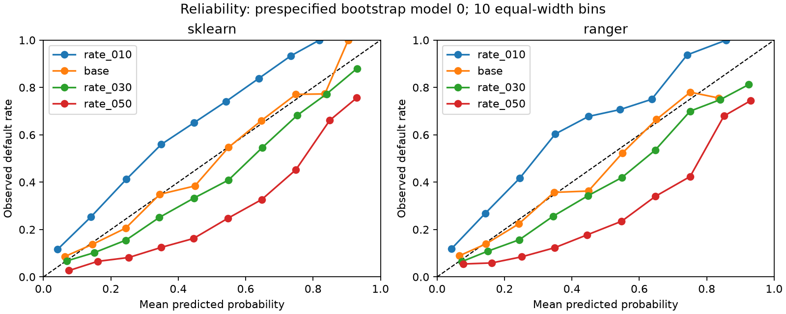

# Windows 实跑结果

本页由 scripts/verify_windows.py 从原始结果复算生成。验证详情见 VERIFIED.json；原 macOS 结果单独保留。

## 完整性

| stage | jobs | recomputed_max_schedule_error | prepared_hashes_verified |
| --- | --- | --- | --- |
| smoke | 8 | 3.331e-16 | 7 |
| phase1_prediction | 12 | 0.0000 | 22 |
| phase2_parallel | 40 | 3.331e-16 | 7 |
| phase3_scaling | 120 | 3.331e-16 | 19 |

测试：21 通过、1 跳过（POSIX 用例）。B=40 的前 20 份抽样和模型种子与 B=20 完全相同。分组划分的训练、验证、测试之间没有重复特征组交叉。

## 阶段一：自然比例预测指标

| scenario | engine | roc_auc_mean | pr_auc_ap_mean | brier_mean | f1_test_at_valid_threshold_mean |
| --- | --- | --- | --- | --- | --- |
| base | ranger | 0.7704 | 0.5474 | 0.1363 | 0.5327 |
| base | sklearn | 0.7679 | 0.5454 | 0.1369 | 0.5318 |
| n_12000 | ranger | 0.7745 | 0.5490 | 0.1359 | 0.5347 |
| n_12000 | sklearn | 0.7729 | 0.5482 | 0.1362 | 0.5348 |
| n_2000 | ranger | 0.7572 | 0.5265 | 0.1397 | 0.5206 |
| n_2000 | sklearn | 0.7537 | 0.5224 | 0.1405 | 0.5198 |

## 阶段二：计时与内存

| engine | mode | seconds_median | seconds_q25 | seconds_q75 | process_seconds_median | speedup | process_speedup | rss_mib_max |
| --- | --- | --- | --- | --- | --- | --- | --- | --- |
| sklearn | outer | 10.0948 | 9.9197 | 10.6883 | 16.4802 | 3.9698 | 2.6157 | 840.1094 |
| sklearn | serial | 40.0744 | 39.7480 | 57.5040 | 43.1078 | 1.0000 | 1.0000 | 177.9414 |
| sklearn | inner | 13.2504 | 12.3828 | 13.5299 | 16.5511 | 3.0244 | 2.6045 | 182.6094 |
| ranger | hybrid | 10.0900 | 9.0200 | 11.7000 | 13.4423 | 3.0496 | 2.4719 | 872.5508 |
| sklearn | hybrid | 11.6715 | 11.6129 | 18.5338 | 17.6797 | 3.4335 | 2.4383 | 504.8242 |
| ranger | outer | 8.4200 | 8.1400 | 8.4200 | 11.9424 | 3.6544 | 2.7823 | 1523.2969 |
| ranger | inner | 9.7400 | 9.7000 | 9.9300 | 12.2318 | 3.1591 | 2.7165 | 358.3047 |
| ranger | serial | 30.7700 | 30.6900 | 61.4200 | 33.2274 | 1.0000 | 1.0000 | 348.3750 |

时间单位为秒；内存为 MiB。speedup 使用核心时间，process_speedup 使用完整进程时间。两者都与同一引擎的串行中位数比较。部分串行计时波动较大，必须同时看 q25/q75 和 timings.csv 的五次记录；中位数排序不构成显著性或稳定排名结论。

## 补充对照：三个划分种子的均值

| split | model | roc_auc | pr_auc_ap | brier | f1_test_at_valid_threshold |
| --- | --- | --- | --- | --- | --- |
| grouped | forest | 0.7739 | 0.5467 | 0.1360 | 0.5377 |
| grouped | logistic | 0.7242 | 0.4970 | 0.1457 | 0.5101 |
| row_stratified | forest | 0.7750 | 0.5491 | 0.1358 | 0.5351 |
| row_stratified | logistic | 0.7237 | 0.4997 | 0.1451 | 0.5005 |

该对照不使用外层 Bootstrap。分组划分也改变了测试集，不能将两种划分的指标差异全部归因于重复记录；3 个种子只提供描述性敏感性检查。详细标准差、逐次预测与划分在 sensitivity/。

## 校准与规模变化

阶段一可靠性曲线：

曲线预先选择 bootstrap_id=0；分箱样本量见 phase1_prediction/calibration.csv。Brier 为概率均方误差，不是纯校准指标。规模变化见 phase3_scaling/timing_summary.csv；分裂内核见 phase2_parallel/kernel/summary.csv。
